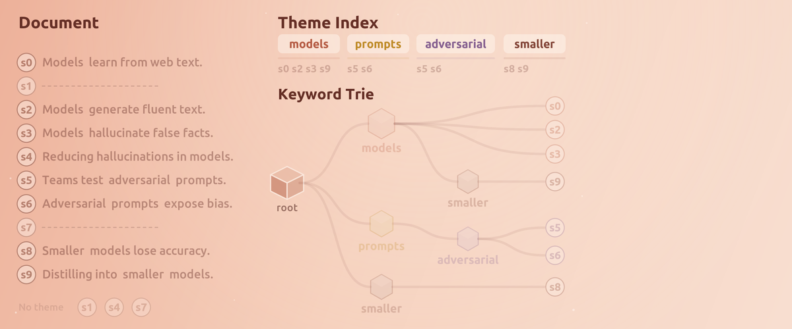

<div align="center">

# SALT

<p align="center">
  
</p>

## Salience-Aware Lexical Trie for Long-Context Compression

[![][emnlp-shield]][emnlp-link]
[![][version-shield]][release-link]
[![][docs-shield]][docs-link]
[![][license-shield]][license-link]
[![][arxiv-shield]][arxiv-link]

</div>

SALT shrinks a long document down to a fixed size before it is sent to a language
model, keeping the sentences that carry the most information. It works with any
model, produces a shorter plain-text prompt, and cuts the compute, memory, and
wait time that long inputs cost.

When a prompt is too long, existing compressors give each sentence a single
relevance score and keep the top-scoring ones until the budget runs out. Under a
tight budget this lets the document's main topic swallow the whole budget, so
smaller but still important points get dropped - a failure called *theme
collapse* (in multi-hop questions, for example, it can keep passages about the
main entity yet lose the one sentence that links it to a second).

SALT first maps the document's recurring themes by organizing each sentence's
keywords into a trie, a small keyword tree ordered by how often those keywords
recur, then spreads the budget across those theme branches before choosing
sentences, so minor themes keep their share instead of being crowded out.
Because the theme map is built once, it can be reused across the turns of a
conversation without re-reading the document.

> The legacy selector described in the paper now defaults to the coverage/CELF
> selector described below. The EMNLP 2026 SALT results can be reproduced
> [here](results/) once the environment is set up.

## 📑 Table of contents

- [Architecture](#-architecture)
- [Installation](#-installation)
- [Quick start](#-quick-start)
- [Chatbot mode](#-chatbot-mode)
- [Results](#-results)
- [Contributing](#-contributing)
- [Reference](#-reference)
- [License](#-license)

## 🧩 Architecture

**How saltChat remembers a conversation.**

<p align="center">
  
</p>


Two phases. **Indexing** reads the document once and builds a keyword trie - a
reusable map of its recurring themes. **Selection** then picks a sentence subset
under a token budget, returned in original document order, query-biased or not.

```text
 INDEXING  ── once per document, reused across turns and budgets
   document → split + junk filter
           → per-sentence keywords   (BGE-small [CLS] attention + knee cutoff)
           → theme salience          (SF = #sentences keeping a word, top quantile)
           → keyword trie            (each sentence's themes, SF-ordered, form a
                                      root-to-leaf path, leaves hold sentence ids)

 SELECTION ── per budget, with or without a query
   maximize theme coverage with CELF lazy-greedy: a pick's value shrinks as its
   theme branches fill, so budget spreads across themes instead of collapsing
   onto the dominant one. A query re-weights the trie (lexical + BGE-semantic)
   without rebuilding it. → compressed prompt, original order, ≤ budget
```


The whole system as a blueprint - this map is kept current as SALT grows,
so it is the fastest way to find where a change belongs:

```text
┌──────────────────────────────────────────────────────────────────────────┐
│                                   SALT                                   │
├──────────────────────────────────────────────────────────────────────────┤
│ 1 INGEST         documents and turns become clean sentences              │
│   documents      pypdf extract · furniture scrub · tables and            │
│                  pseudocode under captions · references dropped          │
│   turns          every exchange, near-duplicates gated out               │
│   background     ingest runs off the reply path                          │
├──────────────────────────────────────────────────────────────────────────┤
│ 2 INDEX          once per sentence, reused by every turn                 │
│   keywords       BGE-small [CLS] attention · knee cutoff                 │
│   keyword trie   SF-ordered paths · theme branches · branch scores       │
│   session trie   one per conversation, in DRAM, grows every turn         │
│                  a §file branch per salt@ file + the conversation        │
├──────────────────────────────────────────────────────────────────────────┤
│ 3 SELECT         once per turn, five questions in order                  │
│   whether        a gate may skip memory                         opt-in   │
│   where          branch scores pick the files, chat always in            │
│   when           a date on the line keeps the other days out             │
│   how much       20% of that, under a 4k-token ceiling                   │
│                  the floor and the hold                         opt-in   │
│   which          coverage (CELF) across turns · branch discounts         │
│                  multi-anchor query · tail-aware                         │
│                  summary mode                                   opt-in   │
├──────────────────────────────────────────────────────────────────────────┤
│ 4 ASSEMBLE       a prompt shaped for the KV cache                        │
│   system         instructions · file inventory · attach@ text   reused   │
│   tail           recent exchanges, append-only, compacted       reused   │
│   newest         SALT memory block + the question               fresh    │
├──────────────────────────────────────────────────────────────────────────┤
│ 5 ANSWER         the model replies, every token accounted                │
│   runners        HF streaming · vLLM + APC · vllm-serve client           │
│   models         model registry · GPU-pinned models                      │
│   kvtrace        per-turn ledger: cached read · fresh write ·            │
│                  output · engine-measured prefix-cache reuse             │
├──────────────────────────────────────────────────────────────────────────┤
│ AGENTS           saltChat asking other models                            │
│   roster         worker + orchestrator endpoints · personas              │
│   delegation     /offload · @NAME · /agent, each piece gets the          │
│                  trie selected for it and commits nothing                │
│   switch agent   rules over the session's numbers set the switches       │
├──────────────────────────────────────────────────────────────────────────┤
│ ENTRY POINTS                                                             │
│   one-shot       salt --data / --doc · eval.py                           │
│   chat           saltChat · saltServe · salt@ and attach@ files          │
│   commands       /doc /model /budget /scope /when /gate /stats           │
│   mcp            salt-mcp, SALT memory for an editor or a runtime        │
└──────────────────────────────────────────────────────────────────────────┘
```

Where each stage lives, module by module, is mapped in
[salt/README.md](salt/README.md) and on the
[Architecture](https://oteomamo.github.io/SALT/latest/architecture/) page.

## 📦 Installation

Requires Python 3.10 and a CUDA GPU with an NVIDIA driver 570 or newer,
since the pinned torch is built for CUDA 12.8 (CPU works for compression,
just slower).

**1. Clone the repository**

```bash
git clone https://github.com/oteomamo/SALT.git
cd SALT
```

**2. Create the environment**

With conda:

```bash
conda env create -f environment.yml
conda activate salt
```

Or with venv:

```bash
python3.10 -m venv .venv
source .venv/bin/activate
pip install -r requirements.txt
```

**3. Install SALT in editable mode**

```bash
pip install -e .
```

This also installs the four console commands: `salt` (one-shot compression,
see [Usage](https://oteomamo.github.io/SALT/latest/usage/)), `saltChat` (interactive chat, see
[Chatbot mode](#-chatbot-mode)), `saltServe` (persistent serving, see
[Serving](https://oteomamo.github.io/SALT/latest/serving/)) and `salt-mcp` (the MCP server, see
[MCP server](https://oteomamo.github.io/SALT/latest/mcp/)).

**4. Authenticate with Hugging Face** - the eval model
(`meta-llama/Llama-3.1-8B-Instruct`) is gated:

```bash
hf auth login
```

Or skip the CLI and export the token directly: `export HF_TOKEN=hf_...`.

**5. (Optional) vLLM backend.** `eval.py` defaults to vLLM,
`saltChat --backend vllm` uses it for prefix caching, and `saltServe`
launches a persistent model server with it. Install it into the `salt`
env through the package's extra, which pins vLLM 0.19.1 to the
transformers release it was tested with:

```bash
pip install -e ".[vllm]"
```

The extra also installs a small server package at a version that keeps
the routes healthy next to newer fastapi releases. Skip this and run `eval.py --backend hf` for a portable run
that needs no vLLM. `saltChat` already defaults to its HF backend.
`saltServe` can also run a vLLM installed in a separate environment
through `--vllm-bin`.

> `bash scripts/setup_env.sh` does steps 2–3 in one shot (add `WITH_VLLM=1` to
> include vLLM).

## 🚀 Quick start

Fetch the LongBench data, then compress every task present and evaluate the
outputs in one command:

```bash
python salt/datasets/download_longbench.py
bash scripts/run_datasets.sh
```

Smoke test (5 samples per task, compression only):

```bash
MAX_SAMPLES=5 RUN_EVAL=0 bash scripts/run_datasets.sh
```

The download step only needs to run once, because the data lands under
`salt/datasets/longbench/data` and stays there.

The script routes each dataset to the right mode automatically, then scores
the results. Every command, flag, and knob is documented on the
[Usage](https://oteomamo.github.io/SALT/latest/usage/) and
[Datasets](https://oteomamo.github.io/SALT/latest/datasets/) pages.

## 🤖 Chatbot mode

`saltChat` is an interactive chat REPL where SALT is the conversation memory:
one persistent trie per conversation grows with every exchange (and any
attached documents), and each turn it compresses the accumulated history into
a query-biased context block under the token budget.

```bash
saltChat --model qwen05 --conversation-id demo1 --doc report.txt
```

Each turn searches only the attached files the question is about and,
when the question names a day, a month or a span, only the exchanges
filed inside it, so the memory block comes from where the answer is.
The block is a fifth of that, and a ceiling that is on by default stops
it at 4096 tokens, so in a long session it keeps the same size and
covers a smaller share of what is remembered. Two opt-in numbers size that block at its edges: `--memory-floor` reads
at least 400 words while a session is young, and `--memory-hold` reads
at most 400 on a turn the memory holds nothing for. A
persistent server started with `saltServe` keeps the model loaded and
its cache warm between chats, so a resumed conversation picks up without
re-reading its documents. The
[Chatbot mode guide](https://oteomamo.github.io/SALT/latest/chatbot/) covers
the concepts, the [Serving](https://oteomamo.github.io/SALT/latest/serving/)
page covers the server, and the
[Options](https://oteomamo.github.io/SALT/latest/options/) page lists every
flag in one line each, including the off-by-default switches that make
long sessions better.

Helper models can take a turn apart and answer the pieces before the
reply is written. The
[Agents](https://oteomamo.github.io/SALT/latest/agents/) page covers the
roster, the round, and the flags that turn it on.

## 🔬 Results

The full per-dataset tables are on the
[Results](https://oteomamo.github.io/SALT/latest/results/) page. The
legacy selector's table, run with vLLM 0.19.1 for Llama-3.1-8B-Instruct and
Ministral-8B-Instruct-2410, is in [results/](results/) with the script that
reproduces it.

## 🤝 Contributing

PRs welcome - see [CONTRIBUTING.md](CONTRIBUTING.md).

## 📝 Reference

SALT is a Main Conference paper at EMNLP 2026. If you find this project
useful for your research, please consider citing it:

```bibtex
@inproceedings{mamo2026salt,
  author    = {Mamo, Oteo and Yi, Hyunjin and Choudhury, Joydhriti and Gao, Shangqian and Yu, Weikuan},
  title     = {{SALT}: Salience-Aware Lexical Trie for Long-Context Compression},
  booktitle = {Proceedings of the 2026 Conference on Empirical Methods in Natural Language Processing},
  month     = {October},
  year      = {2026},
  publisher = {Association for Computational Linguistics},
  url       = {https://aclanthology.org/2026.emnlp-main.1723/}
}
```

The abstract, and how the paper relates to what `main` ships today, are
on the [Paper page](https://oteomamo.github.io/SALT/latest/paper/).

## 📄 License

SALT is released under the [MIT License](LICENSE).

[docs-shield]: https://img.shields.io/badge/docs-oteomamo.github.io%2FSALT-blue
[docs-link]: https://oteomamo.github.io/SALT/
[emnlp-shield]: https://img.shields.io/badge/EMNLP-2026-b85c45
[emnlp-link]: https://aclanthology.org/2026.emnlp-main.1723/
[arxiv-shield]: https://img.shields.io/badge/arXiv-2607.17486-b31b1b.svg
[arxiv-link]: https://arxiv.org/abs/2607.17486
[version-shield]: https://img.shields.io/github/v/tag/oteomamo/SALT?label=version&sort=semver
[release-link]: https://github.com/oteomamo/SALT/tags
[license-shield]: https://img.shields.io/badge/license-MIT-green
[license-link]: LICENSE
